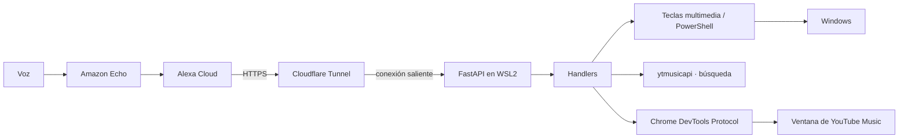

# Alexa-PC

**Controla tu PC y YouTube Music por voz desde un Amazon Echo.**


Alexa no sabe hablar con tu computadora ni con tu reproductor de música. Este proyecto
es el puente: dices un comando al Echo y tu PC responde. Reproduce una canción en
YouTube Music, la agrega a la cola sin cortar lo que suena, sube el volumen, abre una
aplicación, bloquea la pantalla o apaga el equipo. Todo por voz, sin tocar el teclado.

El servidor corre en WSL2 sobre esa misma PC y se expone a Alexa a través de un túnel
saliente, así que no hay puertos abiertos ni IP fija de por medio.

---

## Arquitectura



---

## Comandos de voz

Tras abrir la skill (`"Alexa, abre mi pc"`), la sesión queda activa y puedes encadenar
comandos sin repetir el nombre de invocación.

| Dices | Qué hace |
|---|---|
| `pausa` / `reanuda` | Play/pausa (tecla multimedia) |
| `siguiente` | Salta a la siguiente pista |
| `anterior` | Vuelve a la pista anterior |
| `sube el volumen` | +5 pasos de volumen del sistema |
| `baja el volumen` | −5 pasos de volumen del sistema |
| `toca [canción]` | Busca la canción en YouTube Music y la reproduce en la ventana abierta |
| `toca algo de [artista]` | Abre el canal del artista y lo reproduce |
| `agrega [canción] a la cola` | La añade a la cola sin interrumpir lo que suena |
| `me gusta` / `no me gusta` | Like / dislike a la canción actual |
| `pon aleatorio` | Activa el modo aleatorio |
| `repite` | Cicla entre repetir una, repetir lista y desactivado |
| `abre [sitio]` | Abre una URL conocida en el navegador |
| `abre [app]` / `cierra [app]` | Lanza o cierra un proceso de Windows |
| `bloquea la pantalla` | Bloquea la sesión de Windows |
| `apaga la PC` / `reinicia la PC` | Con confirmación por voz antes de ejecutarse |

Los sitios (`urls.json`) y las aplicaciones (`apps.json`) son mapas editables de
nombre de voz a URL o ejecutable.

---

## Cómo funciona

**El puente Alexa ↔ PC.** El Echo envía cada comando a Alexa Cloud, que lo traduce a un
*intent* y lo manda por HTTPS al endpoint de una skill personalizada. Ese endpoint es un
servidor FastAPI; `ask-sdk-core` deserializa la petición, elige el handler que declara
`can_handle` para ese intent, lo ejecuta y devuelve la respuesta hablada.

**Por qué un túnel saliente.** El servidor vive en WSL2, en una máquina doméstica sin IP
fija ni puertos abiertos al exterior. `cloudflared` mantiene una conexión saliente hacia
la red de Cloudflare; Alexa llama a un dominio público y Cloudflare empuja la petición
por ese túnel hasta el `localhost` de la PC. No se expone la IP de casa ni se configura
el router.

**YouTube Music sin API de reproducción.** `ytmusicapi` resuelve búsquedas (canción →
`videoId`, artista → canal), pero no reproduce nada. Para eso el proyecto controla la
ventana que ya tienes abierta mediante el Chrome DevTools Protocol: en lugar de abrir
pestañas nuevas, localiza la de `music.youtube.com` y la navega, o inyecta clics reales
para acciones como *agregar a la cola*, que no tiene un endpoint estable. El puerto de
depuración de Chrome solo escucha en el `localhost` de Windows, así que un `portproxy`
lo hace alcanzable desde WSL2.

**Control del sistema.** Las teclas multimedia y de volumen se envían con `keybd_event`
a través de PowerShell. Bloquear, apagar y reiniciar son comandos de PowerShell. Abrir y
cerrar aplicaciones es `subprocess` desde WSL2 invocando ejecutables de Windows. Las
acciones destructivas (apagar, reiniciar) piden confirmación por voz antes de correr.

---

## Stack

- **Python 3.12**
- **FastAPI + Uvicorn** — el endpoint HTTP de la skill
- **ask-sdk-core** — Alexa Skills Kit para Python
- **ytmusicapi** — búsqueda en YouTube Music
- **websocket-client** — cliente del Chrome DevTools Protocol
- **Cloudflare Tunnel** (`cloudflared`) — expone el servidor sin abrir puertos
- **systemd** — servicios de arranque (`deploy/`)
- **pytest + GitHub Actions** — pruebas en cada push

---

## Estructura del proyecto

```
.
├── main.py            # Endpoint FastAPI /alexa
├── skill.py           # Registro de handlers (Alexa Skills Kit)
├── config.py          # Carga de .env, apps.json y urls.json
├── apps.json          # Nombre de voz → ejecutable de Windows
├── urls.json          # Nombre de voz → URL
├── handlers/
│   ├── base.py        # Envío de teclas (keybd_event vía PowerShell)
│   ├── music.py       # Reproducción, cola, like, aleatorio, repetir
│   ├── system.py      # Bloquear / apagar / reiniciar (con confirmación)
│   ├── apps.py        # Abrir y cerrar aplicaciones
│   ├── urls.py        # Abrir sitios web
│   └── chrome_cdp.py  # Control de la ventana de YouTube Music vía CDP
├── deploy/            # Unidades systemd
└── tests/
```

---

## Puesta en marcha

Requisitos: Windows con WSL2, una cuenta de desarrollador de Amazon, un dominio propio y
Python 3.12.

1. **Skill de Alexa.** Crea una skill personalizada en el Alexa Developer Console con los
   intents que registra `skill.py` (uno por handler). Apunta su endpoint a
   `https://<tu-subdominio>.<tu-dominio>/alexa`.
2. **Dependencias.** `python -m venv .venv && .venv/bin/pip install -r requirements.txt`
3. **Configuración.** Copia `.env.example` a `.env` y pon el ID de tu skill en `SKILL_ID`.
4. **Auth de YouTube Music.** Genera `browser.json` con `ytmusicapi` (queda fuera del repo).
5. **Túnel.** Instala `cloudflared`, crea un túnel con nombre y enruta
   `<tu-subdominio>.<tu-dominio>` hacia `http://localhost:8000`.
6. **Arranque.** `python main.py` para probar, o instala las unidades de `deploy/` para
   que corra como servicio de systemd.
7. **Ventana de YouTube Music** (necesaria para `toca`, la cola, `me gusta`…). En Windows,
   abre YouTube Music como aplicación de Chrome con el puerto de depuración remota
   activado y redirige ese puerto hacia WSL2 con `netsh portproxy`.

> **Sobre WSL2.** El proyecto corre en WSL2 por preferencia de entorno, no por necesidad:
> todo el stack es Python multiplataforma y `cloudflared` corre nativo en Windows. En
> Windows nativo te ahorras el `portproxy`, la regla de firewall y la detección de IP del
> host (el CDP de Chrome queda en `localhost:9222` directo), y el arranque pasa a ser una
> tarea del Programador de tareas en vez de unidades systemd.

---

## Tests

```
.venv/bin/python -m pytest
```

El mismo comando corre en GitHub Actions en cada push y pull request a `main`.

---

## Cómo agregar un comando

1. Crea un handler en `handlers/`: una clase `AbstractRequestHandler` con `can_handle`
   (qué intent atiende) y `handle` (qué hace y qué responde).
2. Regístralo en `skill.py`.
3. Añade el intent y sus frases en el Alexa Developer Console y reconstruye el modelo.
4. Agrega pruebas en `tests/`.

---

Proyecto personal.
